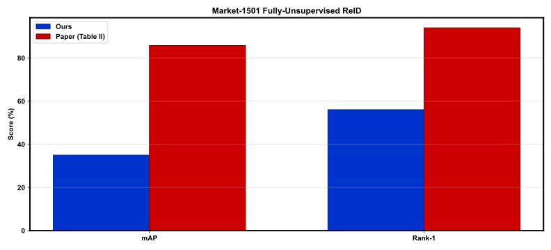
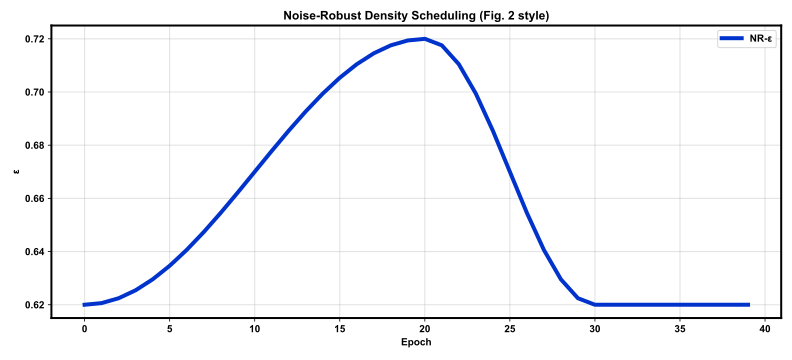
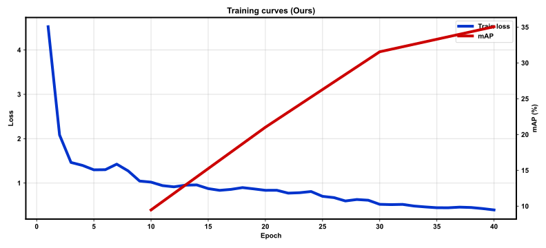

# Report: Large-scale Fully-Unsupervised Re-Identification

Faithful Market-1501 reconstruction of Bertocco et al., TBIOM 2024 (DOI [10.1109/TBIOM.2024.3446964](https://doi.org/10.1109/TBIOM.2024.3446964)).

## Setup

- Backbones: `['resnet50']`
- Image: 256×128, LNS p=1.0
- Epochs: Barlow 15 + unsupervised 40
- Dataset size gate: full_train (0.1388 GiB)

## Market-1501 results

| | mAP | Rank-1 | Rank-5 |
|--|--:|--:|--:|
| **Ours** | 35.06 | 56.06 | 73.72 |
| Paper (Table II, 100%) | 85.8 | 94.0 | — |

Identity labels are used **only** for query/gallery evaluation, never for training.

## Figures

### `outputs/figures/market_map_r1.svg`



### `outputs/figures/eps_schedule.svg`



### `outputs/figures/train_curves.svg`



## Regenerate

```bash
bash scripts/report.sh
```

See `DEVIATIONS.md` and `FIDELITY_AUDIT.md` for known gaps vs the paper.
